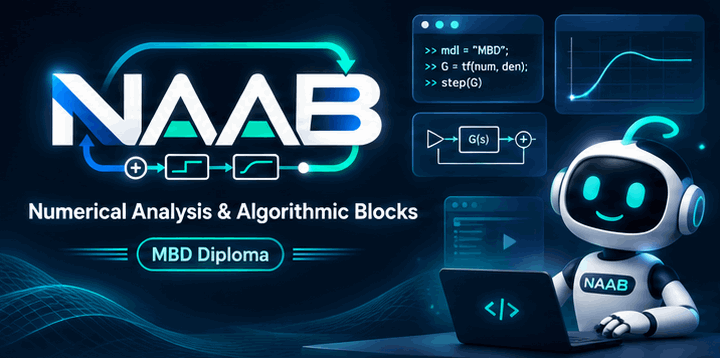
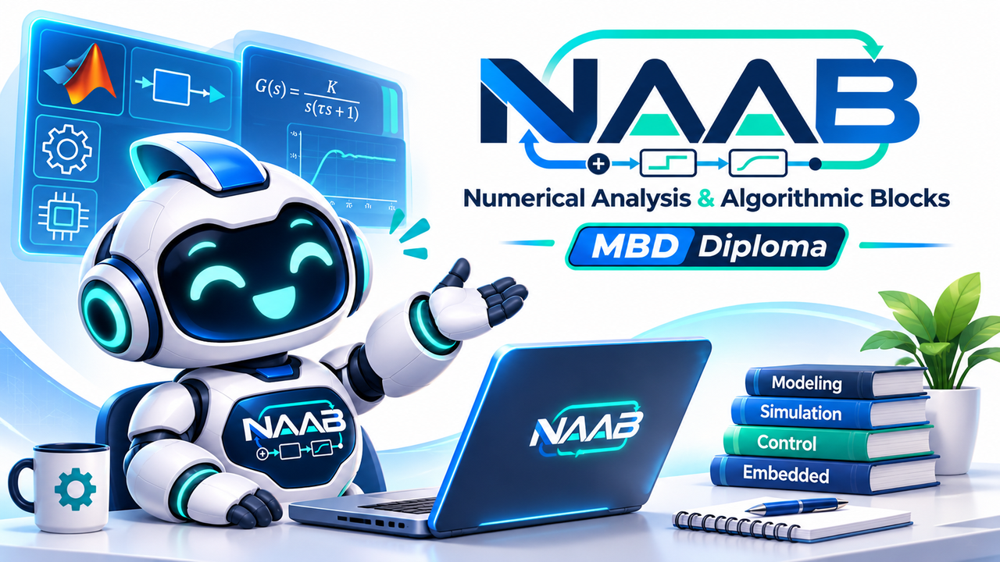
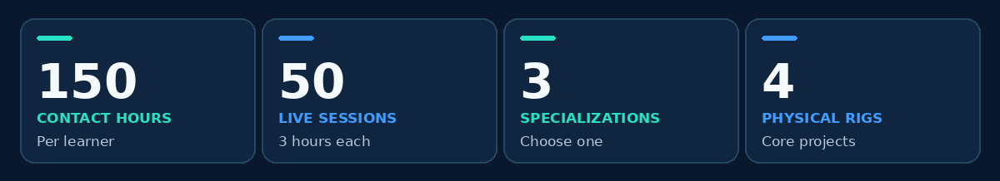
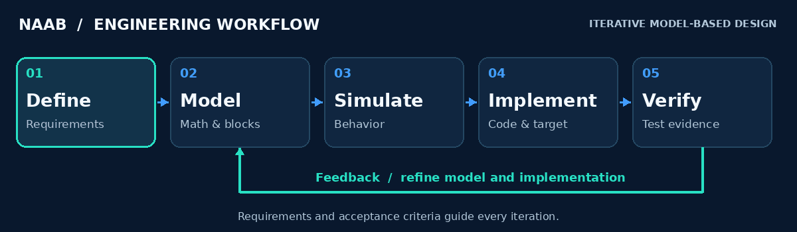
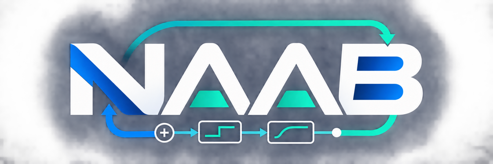

<!-- NAAB public organization profile | Keep engineering evidence separate from conceptual artwork. -->

  <picture>
    <source media="(prefers-reduced-motion: reduce)" srcset="assets/naab-loop-welcome.png">
    
  </picture>

<h1 align="center">From mathematical models to real systems.</h1>

  <strong>NAAB · Numerical Analysis &amp; Algorithmic Blocks</strong> 
  Engineering education through Model-Based Design, numerical computing and embedded implementation.

  <a href="#learning-platform">Platform</a> ·
  <a href="#mbd-professional-diploma">Diploma</a> ·
  <a href="#specializations">Tracks</a> ·
  <a href="#engineering-projects">Projects</a> ·
  <a href="#resources">Resources</a>

  Think. Model. Simulate. Build. · <a href="assets/naab-loop-welcome.png">Static banner</a>

## Learning platform

NAAB is an engineering education initiative connecting mathematical theory, executable models, numerical simulation, embedded implementation and verification. Its proposed web learning platform brings these activities together in a structured learner experience.

  
   NAAB platform artwork — conceptual illustration, not a live application screenshot.

| Workspace | Intended experience |
| :--- | :--- |
| **Learn** | Structured sessions, live derivations, worked examples and study resources. |
| **Practice** | MATLAB, Simulink, C and physical engineering labs with acceptance criteria. |
| **Build** | Version-controlled models, project milestones, submissions and test evidence. |
| **Progress** | Assessments, feedback and a contextual companion: Loop. |

**Platform status:** Planned experience; public launch and access URL are not yet confirmed.
<!-- Replace the status line with verified launch information and a real platform link when approved. -->

## MBD Professional Diploma

  

A planned **150-contact-hour** pathway across **50 sessions**, combining mathematical foundations, guided labs, implementation and assessment. Learners complete the common core and one of three specialization tracks.

| Stage | Focus | Hours |
| :--- | :--- | ---: |
| Introduction | MBD, Git and toolchain foundations | 6 |
| Module A | MATLAB, C, Simulink/Simscape and modeling foundations | 36 |
| Module B | Mathematical modeling, control, sensor realism and testing | 36 |
| Module C | Requirements, verified implementation and physical engineering projects | 36 |
| Specialization | One selected track with a separate project | 36 |
| **Total** | **50 three-hour sessions** | **150** |

Two optional, free AI sessions sit outside the 150 diploma contact hours. Assessment combines labs, mathematical problem-solving, project demonstrations and individual oral defense.

### Specializations

The curriculum requires all three choices to be offered in every cohort; each learner selects one 12-session track.

| Track | Engineering focus | Project |
| :--- | :--- | :--- |
| **T1 · Electric Machines & Drives** | PMSM modeling, dq-axis control, Clarke/Park transforms | Independently derive, implement and verify FOC and SVPWM, simulation-first. |
| **T2 · Embedded & Automotive Software** | Embedded C, real-time systems and automotive communications | Physical RTOS implementation with measured timing; simulated CAN/UDS permitted. |
| **T3 · Sensing, Signals & Communications** | Signal processing, state estimation and sensor fusion | Scalar Kalman filtering and two-sensor fusion using validated simulated or recorded data. |

## Engineering projects

One team capstone evolves across Modules A, B and C. Every learner must also complete four independent physical MBD project streams, with a separate specialization project.

| Physical core project | Engineering focus |
| :--- | :--- |
| **PWM–RC–ADC** | Signal generation, filtering, acquisition and model-to-measurement comparison. |
| **DC motor** | Dynamic modeling, feedback control and verified physical implementation. |
| **Servo** | Actuation, command behavior and measurable response. |
| **Stepper motor** | Motion sequencing, implementation and verification with explicit measurement limits. |

Simulation supports design and verification; it does not replace the mandatory physical core projects.

## Engineering workflow

  <picture>
    <source media="(prefers-reduced-motion: reduce)" srcset="assets/naab-workflow.png">
    
  </picture>
   <a href="assets/naab-workflow.png">Static workflow diagram</a> · Conceptual process illustration.

**Define → Model → Simulate → Implement → Verify → Iterate**

Engineering work is grounded in traceable requirements, mathematical assumptions, reproducible models and explicit acceptance criteria. Verification feeds back into the design; actual toolchain and hardware evidence are required where applicable.

### Technology stack

  
  
  
  
  

Numerical computing · system dynamics · control engineering · signal processing · real-time software · engineering verification.

Tool names describe the planned curriculum, not vendor affiliation. Licenses and target hardware must pass preflight before use.

## Resources

This GitHub organization is intended to host approved public examples and resources for the NAAB engineering ecosystem. Public repositories will be linked here and pinned when they are available and approved.

For now, these official external resources provide useful starting points:

| Topic | Documentation |
| :--- | :--- |
| Numerical computing &amp; modeling | [MATLAB](https://www.mathworks.com/help/matlab/) · [Simulink](https://www.mathworks.com/help/simulink/) |
| Physical modeling &amp; supervisory logic | [Simscape](https://www.mathworks.com/help/simscape/) · [Stateflow](https://www.mathworks.com/help/stateflow/) |
| Version control | [Git documentation](https://git-scm.com/doc) · [GitHub Docs](https://docs.github.com/) |

Student/team repositories, instructor-only materials and assessment solutions are kept separate from public releases. Use the relevant repository's own documentation and issue tracker once public repositories are released.

## Meet Loop

  
   <strong>Loop · Your Model-Based Design companion</strong>

Loop embodies the feedback cycle: observe, analyze, improve and iterate. The character is designed for guidance, troubleshooting and progress celebrations within the learning platform.

  <a href="assets/loop-pose-library.png">Poses &amp; reactions</a> ·
  <a href="assets/loop-achievement.png">Achievement artwork</a> ·
  <a href="assets/naab-diploma-banner.png">Diploma identity</a>

---

Program status: the curriculum is defined; external host authorization, credential arrangements, equipment feasibility and technical delivery validation remain pending. Illustrations are conceptual, not application screenshots or verified engineering results.

  
   <strong>Think. Model. Simulate. Build.</strong>

