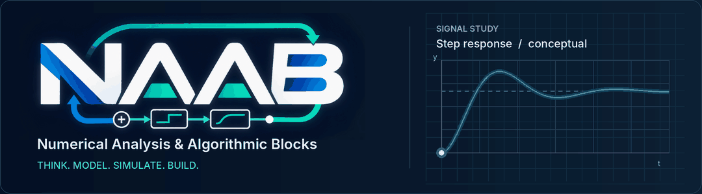
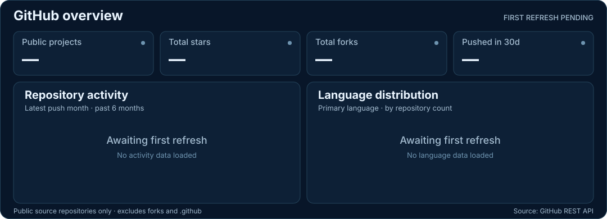

  <picture>
    <source media="(prefers-reduced-motion: reduce)" srcset="assets/naab-hero.png">
    
  </picture>

<h3 align="center">Engineering from mathematics to implementation.</h3>

  NAAB is building an ecosystem of engineering tools, a web learning platform and practical resources for model-based design, numerical computing and embedded systems.

MODEL-BASED DESIGN &nbsp;·&nbsp; SIMULATION &nbsp;·&nbsp; CONTROL &nbsp;·&nbsp; EMBEDDED SOFTWARE &nbsp;·&nbsp; AI

  <picture>
    <source media="(max-width: 600px)" srcset="assets/naab-activity-mobile.svg">
    
  </picture>

Explore our pinned repositories and projects below. &nbsp;·&nbsp; <a href="assets/naab-hero.png">Static header</a>

