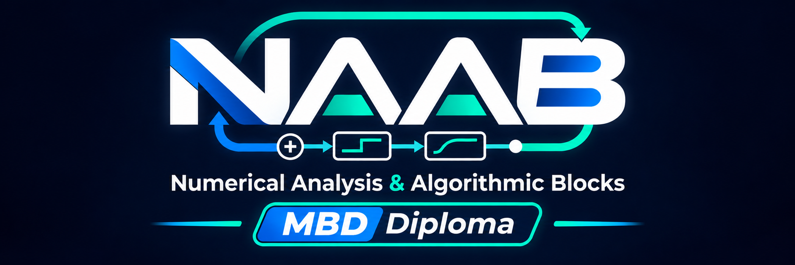

  

<h3 align="center">Think. Model. Simulate. Build.</h3>

From mathematical models to real-world engineering systems.

---

## About NAAB

**NAAB — Numerical Analysis & Algorithmic Blocks** is an engineering education initiative focused on Model-Based Design (MBD), numerical computing, control systems, and embedded software development.

Our goal is to connect mathematical foundations with simulation, algorithm implementation, and reproducible engineering practice.

## Engineering focus

**MATLAB · Simulink · Simscape · Stateflow · C · Git**

| Domain | Focus |
| :--- | :--- |
| Numerical computing | MATLAB, numerical methods, engineering data |
| Model-Based Design | Simulink, Simscape, Stateflow, system modeling |
| Control engineering | System dynamics, feedback, controller design |
| Embedded software | C, microcontrollers, real-time systems, implementation |
| Engineering verification | Requirements, testing, reproducible workflows |

## MBD Professional Diploma

Our curriculum is designed around a **150-hour, 50-session** learner pathway combining mathematical foundations, guided engineering labs, and project-based assessment.

| Stage | Planned contact hours |
| :--- | ---: |
| Introduction and toolchain foundations | 6 |
| Module A — Engineering and modeling foundations | 36 |
| Module B — Modeling, control and verification | 36 |
| Module C — Implementation and physical projects | 36 |
| One selected specialization | 36 |
| **Total** | **150** |

### Specialization tracks

- **Electric Machines & Drives** — motor modeling, field-oriented control, PWM and modulation.
- **Embedded & Automotive Software** — embedded C, RTOS, automotive communication concepts and verification.
- **Sensing, Signals & Communications** — signal processing, estimation and sensor fusion.

Two optional AI learning sessions are planned outside the 150-hour diploma pathway.

## Our engineering workflow

`Requirements` → `Mathematical Modeling` → `Simulation` → `Implementation` → `Verification` → `Deployment`

We emphasize traceable requirements, validated numerical results, version-controlled models and code, and evidence-based engineering decisions.

## Meet Loop

  

**Loop** is our engineering learning companion, representing curiosity, feedback, iteration, and continuous improvement.

## Repositories and resources

This organization is intended to host approved public resources and engineering examples as they become available. Student submissions, restricted learning materials, instructor solutions and unpublished content are managed separately.

> Program delivery, credential arrangements and toolchain readiness remain subject to the applicable approvals and technical validation. MATLAB, Simulink and related product names are used descriptively; no affiliation or endorsement is implied.

---

<strong>NAAB</strong> Numerical Analysis &amp; Algorithmic Blocks <em>Think. Model. Simulate. Build.</em>

